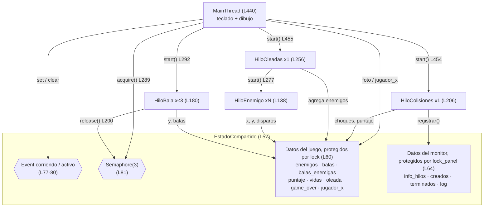
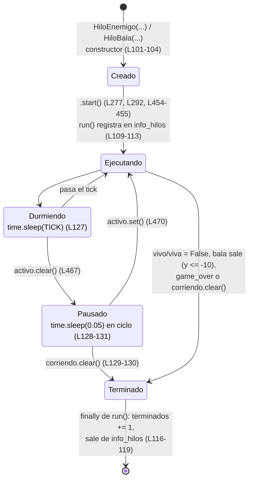
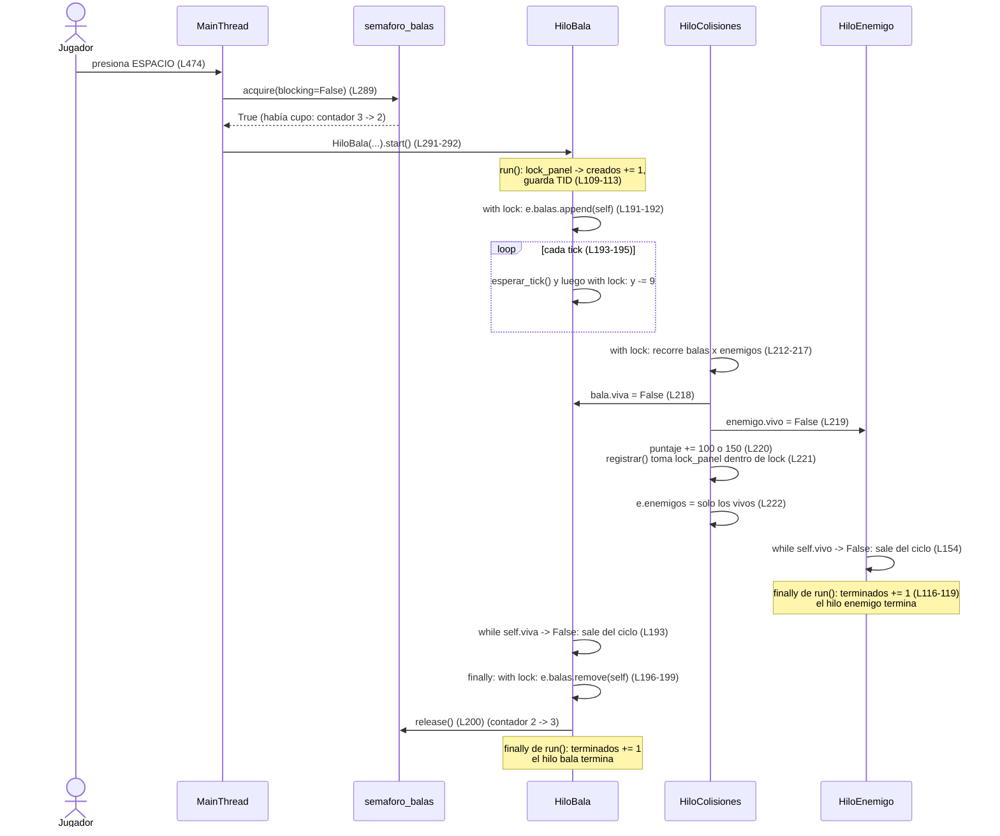

# Galaga con hilos en Python

**Materia:** Programación Concurrente, Distribuida y Paralela\
**Autor:** Carlos Enrique Álape Hernández\
**Código:** 39671\
**Fecha:** 7 de octubre de 2026\
**Archivo fuente:** `galaga_hilos.py`

> Convención: en este documento `L123` significa "línea 123 de `galaga_hilos.py`".

---

## Tabla de contenido

- 2\. [Objetivo](#2-objetivo)
- 3\. [Requisitos e instalación](#3-requisitos-e-instalación)
- 4\. [Arquitectura](#4-arquitectura)
- 5\. [Ciclo de vida de un hilo en el juego](#5-ciclo-de-vida-de-un-hilo-en-el-juego)
- 6\. [Sincronización](#6-sincronización)
- 7\. [Diagrama de secuencia: un disparo](#7-diagrama-de-secuencia-un-disparo)
- 8\. [Monitor de hilos](#8-monitor-de-hilos)
- 9\. [Concurrencia vs. paralelismo y el GIL](#9-concurrencia-vs-paralelismo-y-el-gil)
- 10\. [Explicación del código por bloques](#10-explicación-del-código-por-bloques)
- 11\. [Experimentos](#11-experimentos)
- 12\. [Preguntas frecuentes](#12-preguntas-frecuentes-de-sustentación)
- 13\. [Conclusiones](#13-conclusiones)

---

## 2. Objetivo

Analizar la **construcción y gestión de hilos** (`threading.Thread`) mediante un videojuego tipo *Galaga*. Cada entidad del juego corre en su propio hilo: cada enemigo, cada bala del jugador, el detector de colisiones y el generador de oleadas. Esto permite observar en un caso concreto:

- la creación (`start()`) y la terminación de hilos;
- el acceso concurrente a memoria compartida y su protección con `Lock`;
- la limitación de recursos con `Semaphore`;
- la coordinación entre hilos con `Event` (pausa y apagado);
- el cierre ordenado con `join()`;
- el monitoreo en vivo de los hilos del proceso (`threading.enumerate()`, `active_count()`, `get_native_id()`).

---

## 3. Requisitos e instalación

| Requisito         | Versión usada                              |
| ----------------- | ------------------------------------------- |
| Python            | 3.14.7 (CPython estándar, con GIL)         |
| pygame-ce         | 2.5.8 (SDL 2.32.10)                         |
| Sistema operativo | Windows 10 (también funciona en Linux/Mac) |

### Instalación (Windows, PowerShell)

```powershell
mkdir galaga-hilos
cd galaga-hilos
python -m venv .venv
.venv\Scripts\Activate.ps1
pip install pygame-ce
```

En Linux/Mac, el venv se activa con `source .venv/bin/activate`.

> Se usa `pygame-ce` (la edición comunitaria de pygame). En el código se importa igual, con `import pygame` (L30). No se deben instalar `pygame` y `pygame-ce` al mismo tiempo.

### Ejecución

```bash
python galaga_hilos.py
```

Al cerrar, la terminal imprime cuántos hilos se crearon y cuántos terminaron (L495).

### Controles

| Tecla   | Acción                                          | Código   |
| ------- | ------------------------------------------------ | --------- |
| ← →   | Mover la nave                                    | L480–483 |
| ESPACIO | Disparar (crea un `HiloBala`)                   | L474–475 |
| P       | Pausar / reanudar (Event `activo`)              | L465–471 |
| H       | Mostrar el TID del hilo encima de cada personaje | L472–473 |
| ESC     | Salir (Event `corriendo`)                       | L463–464 |

---

## 4. Arquitectura

### 4.1 Diagrama de hilos y estado compartido



**Patrón general:** los hilos de las entidades **producen** datos (posiciones, banderas) y el `MainThread` los **consume** para dibujar. Ningún hilo distinto del principal llama a funciones de pygame, porque el dibujo y los eventos de SDL deben hacerse desde el hilo principal.

### 4.2 Tabla de hilos

| Hilo (clase)                             | Cantidad                                                                         | Responsabilidad                                                                                                          | Ciclo de vida                                                               | Quién lo crea                                |
| ---------------------------------------- | -------------------------------------------------------------------------------- | ------------------------------------------------------------------------------------------------------------------------ | --------------------------------------------------------------------------- | --------------------------------------------- |
| `MainThread` (función `main`, L440) | 1                                                                                | Lee el teclado, mueve la nave, dibuja el juego y el panel, coordina pausa y salida                                       | Todo el programa                                                            | El intérprete de Python                      |
| `HiloOleadas` (L256)                   | 1                                                                                | Cuando no quedan enemigos, crea una oleada nueva y lanza un hilo por enemigo                                             | Desde L455 hasta salir o *game over*                                       | `MainThread` (L455)                         |
| `HiloColisiones` (L206)                | 1                                                                                | Revisa choques bala↔enemigo, bala enemiga↔jugador y enemigo↔jugador; mueve las balas enemigas; maneja vidas y puntaje | Desde L454 hasta salir o *game over*                                       | `MainThread` (L454)                         |
| `HiloEnemigo` (L138)                   | 16 a 40 por oleada: `filas * 8`, con `filas = min(2 + oleada // 2, 5)` (L268) | Moverse a su puesto, balancearse, hacer picadas hacia el jugador y disparar                                              | Hasta que `vivo = False`, *game over* o salida                           | `HiloOleadas` (L272, L277)                  |
| `HiloBala` (L180)                      | Máximo `MAX_BALAS = 3` a la vez (L39)                                          | Subir por la pantalla hasta salir o impactar                                                                             | Corta: nace al presionar ESPACIO y muere al salir (`y <= -10`) o impactar | `MainThread`, en `disparar()` (L291–292) |

Las **balas enemigas** no son hilos. Son listas `[x, y]` dentro de `estado.balas_enemigas` (L70). Las crea `HiloEnemigo` (L173) y las mueve `HiloColisiones` (L226–232).

---

## 5. Ciclo de vida de un hilo en el juego



Relación con el código:

1. **Creado.** Se construye el objeto. `HiloJuego.__init__` llama a `super().__init__(name=nombre, daemon=True)` (L103). Todavía no existe un hilo del sistema operativo.
2. **`start()`.** Python crea el hilo del sistema operativo, y ese hilo ejecuta `run()` (L106). Si se llamara a `run()` directamente, el código correría en el hilo que lo llama y no en uno nuevo.
3. **Ejecutando.** `run()` registra el hilo en el monitor bajo `lock_panel`: suma `creados` y guarda el TID real con `threading.get_native_id()` (L109–113). Luego llama a `ejecutar()` (L115), que contiene la lógica propia de cada clase.
4. **Durmiendo / Pausado.** En cada vuelta del ciclo, el hilo llama a `esperar_tick()` (L124–132). Allí duerme `TICK = 1/60` s (L127). Si el Event `activo` está desactivado, el hilo se queda en el ciclo de pausa (L128–131): sigue vivo, pero no avanza.
5. **Terminado.** `esperar_tick()` devuelve `False` cuando `corriendo` está desactivado o hay `game_over` (L132). Además, cada clase tiene su propia condición: `self.vivo` (L154) o `self.viva and self.y > -10` (L193). Cuando la condición falla, `ejecutar()` termina, el `finally` de `run()` suma `terminados` y quita el hilo de `info_hilos` (L116–119), y el hilo muere. **Ningún hilo se mata desde afuera.**

---

## 6. Sincronización

### 6.1 `Lock`: exclusión mutua sobre el estado del juego

Fragmento real de `HiloColisiones.ejecutar()` (L212–220):

```python
            with e.lock:
                # 1) Balas del jugador contra enemigos
                for bala in e.balas:
                    for enemigo in e.enemigos:
                        if bala.viva and enemigo.vivo and \
                           abs(bala.x - enemigo.x) < 16 and abs(bala.y - enemigo.y) < 14:
                            bala.viva = False          # el hilo bala vera esto y terminara
                            enemigo.vivo = False       # el hilo enemigo vera esto y terminara
                            e.puntaje += 150 if enemigo.en_picada else 100
```

**Dónde se usa `estado.lock`:**

- movimiento del enemigo (L156);
- alta, movimiento y baja de la bala (L191, L194, L197);
- colisiones (L212);
- revisar la lista y agregar enemigos (L262, L275);
- mover la nave (L479);
- foto para dibujar (L308).

**Qué problema resuelve.** Hay varios hilos que leen y escriben las mismas listas y contadores. El Lock garantiza que solo un hilo a la vez esté dentro de una sección crítica. Así:

- `e.puntaje += ...` (leer, sumar, escribir) se hace completo, sin interrupciones de otros hilos;
- la revisión "¿la bala y el enemigo siguen vivos? entonces los marco como muertos" es atómica, y una misma bala no puede destruir dos enemigos;
- las listas no cambian mientras otro hilo las recorre.

**Qué pasa sin él (condiciones de carrera):**

- **Actualizaciones perdidas:** dos hilos leen el mismo `puntaje` y uno sobrescribe la suma del otro.
- **Listas modificadas durante el recorrido:** si `HiloBala` hace `e.balas.remove(self)` (L199) mientras Colisiones recorre `e.balas`, el `for` puede saltarse elementos, y una bala puede atravesar a un enemigo sin que se detecte el choque.
- **Enemigos "zombi":** Colisiones reasigna `e.enemigos = [en for en in e.enemigos if en.vivo]` (L222). Si `HiloOleadas` hace `append` a la lista vieja entre la construcción y la asignación, ese enemigo queda fuera de la lista, pero su hilo sigue corriendo y disparando.
- **Datos inconsistentes al dibujar:** el `MainThread` podría leer el `x` nuevo y el `y` viejo de un enemigo.

**Secciones críticas cortas.** El `MainThread` toma el lock solo para copiar los datos (una "foto") y dibuja después de soltarlo (L307–313):

```python
    # Tomamos una "foto" del estado con el lock y dibujamos sin bloquear a los demas
    with estado.lock:
        enemigos = [(en.x, en.y, en.color, en.name) for en in estado.enemigos]
        balas = [(b.x, b.y, b.name) for b in estado.balas]
        balas_en = [tuple(b) for b in estado.balas_enemigas]
        jx, jy = estado.jugador_x, estado.jugador_y
        puntaje, vidas, oleada, game_over = estado.puntaje, estado.vidas, estado.oleada, estado.game_over
```

Del mismo modo, `HiloOleadas` toma el lock en cada `append` (L275–276) y **duerme fuera del lock** (L278).

#### Regla de orden de locks (prevención de *deadlock*)

Hay dos locks: `lock` (juego) y `lock_panel` (monitor). La regla está escrita en L59–64:

```python
        # Lock del juego: quien quiera leer/escribir posiciones, listas o puntaje lo toma.
        self.lock = threading.Lock()
        # Lock del panel: protege el registro de hilos y el log.
        # Regla para evitar deadlock: se puede tomar lock_panel estando dentro de lock,
        # pero NUNCA al reves.
        self.lock_panel = threading.Lock()
```

- `HiloColisiones` llama a `e.registrar(...)`, que toma `lock_panel` (L91), **estando dentro** de `lock` (L221, L247, L250). Ese es el orden permitido: primero `lock`, después `lock_panel`.
- `HiloJuego.run()` (L109, L117) y `dibujar_panel` (L367) toman solo `lock_panel`.
- `dibujar_juego` toma `lock` (L308), lo suelta, y después toma `lock_panel` (L314). No los anida.
- Ningún código toma `lock` estando dentro de `lock_panel`.

Un deadlock necesita una **espera circular**: el hilo A tiene `lock` y espera `lock_panel`, mientras el hilo B tiene `lock_panel` y espera `lock`. Si todos adquieren los locks en el mismo orden, esa espera circular no puede formarse.

### 6.2 `Semaphore`: límite de balas simultáneas

Fragmentos reales: `disparar()` (L289–292) y el `finally` de `HiloBala.ejecutar()` (L196–200):

```python
    if estado.semaforo_balas.acquire(blocking=False):
    # if estado.semaforo_balas.acquire():
        HiloBala(estado, f"Bala-{next(contador_balas)}",
                 estado.jugador_x, estado.jugador_y - 18).start()
```

```python
        finally:
            with e.lock:
                if self in e.balas:
                    e.balas.remove(self)
            e.semaforo_balas.release()      # libera el cupo -> se puede volver a disparar
```

**Qué problema resuelve.** El semáforo es un **contador de cupos** que empieza en `MAX_BALAS = 3` (L39, L81):

- `acquire()` resta uno;
- `release()` suma uno;
- si el contador está en 0, `acquire()` no puede pasar.

Así hay como máximo 3 hilos `HiloBala` vivos a la vez. El cupo lo toma el `MainThread` y lo devuelve el propio hilo de la bala cuando termina.

- **`blocking=False`.** Si no hay cupo, `acquire` devuelve `False` de inmediato. El hilo principal no se queda esperando: solo registra "Semaforo en 0: espera un cupo" (L294), y la interfaz nunca se congela.
- **`release()` en `finally`.** El cupo se devuelve siempre, sin importar cómo termine la bala: porque salió de la pantalla, porque impactó, por *game over* o por un error.

**Qué pasa sin él.**

- Sin semáforo, cada pulsación de ESPACIO crea un hilo nuevo, sin límite.
- Si faltara el `release()`, o no estuviera en `finally`, se perderían cupos. Tras 3 disparos el contador quedaría en 0 y el jugador no podría volver a disparar.

**¿Por qué no un `Lock`?** Un `Lock` tiene un solo cupo: está libre u ocupado. El juego necesita *N* cupos, y eso es exactamente un `Semaphore(N)`.

### 6.3 `Event`: apagado y pausa

Fragmento real de `HiloJuego.esperar_tick()` (L124–132):

```python
    def esperar_tick(self):
        """Duerme un tick (cede la CPU a otros hilos) y respeta la pausa.
        Devuelve False cuando el juego se apaga, para que el hilo salga de su ciclo."""
        time.sleep(TICK)
        while not self.estado.activo.is_set():       # pausa
            if not self.estado.corriendo.is_set():
                return False
            time.sleep(0.05)
        return self.estado.corriendo.is_set() and not self.estado.game_over
```

**Los dos Event** (L77–80). Ambos empiezan activados (`set`):

| Event         | Activado (`set`)  | Desactivado (`clear`)               | Dónde se desactiva                                            |
| ------------- | ------------------- | ------------------------------------- | -------------------------------------------------------------- |
| `corriendo` | El juego sigue vivo | Todos los hilos deben terminar        | ESC (L464) o cerrar la ventana (L461)                          |
| `activo`    | No hay pausa        | Los hilos quedan en el ciclo de pausa | Tecla P (L467); se reactiva en L470 y antes del cierre en L491 |

**Qué problema resuelve.** El `MainThread` necesita comunicar una orden a **todos** los hilos al mismo tiempo (pausar o apagarse), sin conocer cada hilo ni sus referencias. El `Event` es una bandera compartida y segura entre hilos: un hilo la cambia y todos los demás la consultan.

**Qué pasa sin él.**

- No habría una forma limpia de detener los hilos: Python no tiene un "kill" para hilos.
- Al cerrar, los hilos seguirían en su ciclo `while`.
- La pausa tendría que implementarse hilo por hilo.

### 6.4 `join()`: cierre ordenado

Fragmento real de `main()` (L490–495):

```python
    # Cierre ordenado: avisar a todos los hilos y esperarlos con join()
    estado.activo.set()                       # por si estaba en pausa
    for hilo in threading.enumerate():
        if hilo is not threading.main_thread():
            hilo.join(timeout=1)
    print(f"Hilos creados en total: {estado.creados} | terminados: {estado.terminados}")
```

**Qué problema resuelve.**

- `join()` bloquea al `MainThread` hasta que el hilo indicado termine. `timeout=1` limita la espera a 1 segundo por hilo.
- Antes del `join`, `corriendo` ya fue desactivado. Por eso cada hilo sale de su ciclo en su siguiente tick y el `join` retorna pronto.
- El `print` final permite verificar que `creados == terminados`, es decir, que ningún hilo quedó colgado.

**Qué pasa sin él.**

- Todos los hilos son *daemon* (L103), así que el programa terminaría de todos modos.
- Pero el proceso podría cortar a los hilos en cualquier punto, incluso dentro de una sección crítica.
- El conteo final de `terminados` sería menor que el de `creados`.

---

## 7. Diagrama de secuencia: un disparo



Las últimas dos ramas (enemigo y bala) ocurren **en paralelo lógico**: cada hilo descubre su bandera en su propio tick, sin un orden fijo entre ellos.

---

## 8. Monitor de hilos

El panel derecho lo dibuja `dibujar_panel()` (L352) en el `MainThread`, en cada frame.

**Cómo obtiene los datos:**

1. Lee la lista de hilos vivos con `threading.enumerate()` (L366).
2. Copia los datos del monitor bajo `lock_panel` (L367–370).
3. Agrega el número de hilos vivos al historial (L371).

| Parte del panel                              | Qué muestra                                                                   | De dónde sale el dato                                                                                                                                                                                                | Líneas                         |
| -------------------------------------------- | ------------------------------------------------------------------------------ | --------------------------------------------------------------------------------------------------------------------------------------------------------------------------------------------------------------------- | ------------------------------- |
| **Vivos ahora**                        | Hilos existentes en este instante, incluido `MainThread`                      | `threading.active_count()`                                                                                                                                                                                          | L380                            |
| **Creados / Terminados**               | Total de hilos de juego que han iniciado y que han terminado                   | Contadores `estado.creados` y `estado.terminados`, que se suman en `HiloJuego.run()` bajo `lock_panel`                                                                                                         | L110, L118, L381                |
| **Estado**                             | "corriendo" o "PAUSADO (Event activo=clear)"                                   | `estado.activo.is_set()`                                                                                                                                                                                            | L382–383                       |
| **Conteo por tipo** (con barras)       | Cuántos hilos hay de cada tipo: Principal, Oleadas, Colisiones, Enemigo, Bala | Cruza `threading.enumerate()` con el `tipo` guardado en `info_hilos`; "Principal" se fija en 1                                                                                                                   | L373–377, L386–391            |
| **Semáforo balas**                    | Cupos libres de 3, en cuadros verdes (libre) o rojos (ocupado)                 | `estado.semaforo_balas._value` (atributo interno de CPython, usado solo para mostrarlo)                                                                                                                             | L395–400                       |
| **Hilos vivos en el tiempo**           | Gráfica de las últimas 150 mediciones                                        | `len(threading.enumerate())`, guardado en `estado.historial` (`deque(maxlen=150)`)                                                                                                                              | L88, L371, L402–412            |
| **Lista de hilos**                     | Nombre, **TID** y edad de hasta 10 hilos, ordenados por tipo              | TID de `MainThread`: `threading.main_thread().native_id` (L417). TID de los demás: `threading.get_native_id()`, que cada hilo toma al iniciar dentro de `run()` (L112). Edad: `time.time() - inicio` (L419) | L415–426                       |
| **Eventos**                            | Los últimos 7 mensajes (quién hizo qué)                                     | `estado.log` (`deque(maxlen=7)`), alimentado por `registrar()`                                                                                                                                                  | L87, L90–92, L429–432         |
| **TID sobre cada personaje** (tecla H) | El TID encima de cada enemigo, de cada bala y de la nave                       | Mismo diccionario `info_hilos` (L314–315) y `threading.main_thread().native_id`                                                                                                                                   | L322–323, L326–327, L334–335 |

**Diferencia entre las tres funciones de `threading`:**

- `threading.enumerate()` devuelve la **lista** de objetos `Thread` vivos.
- `threading.active_count()` devuelve **cuántos** son; equivale a `len(threading.enumerate())`.
- `threading.get_native_id()` devuelve el **ID que el sistema operativo** asignó al hilo que la llama. Por eso se llama *dentro* de `run()`, ya en el hilo nuevo.

El TID demuestra que cada `HiloEnemigo` y cada `HiloBala` es un hilo real del sistema operativo. Con la tecla H, el número que aparece sobre cada enemigo coincide con el de la lista del panel.

---

## 9. Concurrencia vs. paralelismo y el GIL

**Concurrencia** significa que varias tareas avanzan *intercaladas* en el tiempo. **Paralelismo** significa que se ejecutan *al mismo tiempo* en núcleos distintos.

El proyecto se ejecuta con CPython 3.14.7 en su compilación estándar, con el **GIL** (*Global Interpreter Lock*) activo. Se verificó con `sys._is_gil_enabled() == True`. El GIL permite que **solo un hilo ejecute bytecode de Python a la vez**. Por lo tanto:

- Aunque haya decenas de hilos del sistema operativo (cada uno con su TID), el código Python de esos hilos **se intercala**: hay **concurrencia, no paralelismo**.
- El juego funciona bien porque los hilos pasan casi todo el tiempo **durmiendo**:
  - cada tick hace un poco de aritmética y luego `time.sleep(TICK)` (L127);
  - `time.sleep` **libera el GIL**, así que mientras un hilo duerme los demás pueden ejecutarse;
  - la carga es de tipo "espera", no de cálculo intensivo.
- **El GIL no reemplaza al `Lock`.** El GIL protege las estructuras internas del intérprete, pero puede cambiar de hilo entre dos instrucciones de bytecode. Por ejemplo, entre leer `puntaje` y escribir el nuevo valor. Por eso la lógica del juego sigue necesitando `estado.lock`.

**Cuándo se usaría `multiprocessing`.** Cuando la carga es de **cálculo intensivo (CPU-bound)** y se quiere paralelismo real en varios núcleos. Por ejemplo, física o inteligencia artificial para miles de entidades, o procesamiento de imágenes. Cada proceso tiene su propio intérprete y su propio GIL, y por eso sí corren en paralelo. El costo es que **no comparten memoria**: el estado tendría que comunicarse con `Queue`, `Pipe` o memoria compartida, que es más caro y más complejo que el `EstadoCompartido` de este proyecto.

---

## 10. Explicación del código por bloques

### 10.1 Tabla resumen

| Bloque                         | Líneas   | Propósito                                                            | Entradas                                                          | Salidas / efectos                                           | Hilo en que corre                   |
| ------------------------------ | --------- | --------------------------------------------------------------------- | ----------------------------------------------------------------- | ----------------------------------------------------------- | ----------------------------------- |
| Configuración                 | L35–51   | Tamaños, `FPS`, `TICK`, `MAX_BALAS` y colores                   | —                                                                | Constantes globales                                         | Al importar el módulo (MainThread) |
| `EstadoCompartido.__init__`  | L58–88   | Crear la memoria compartida y las primitivas de sincronización       | —                                                                | Listas, contadores, 2 `Lock`, 2 `Event`, 1 `Semaphore` | MainThread (L451)                   |
| `EstadoCompartido.registrar` | L90–92   | Agregar un mensaje con hora al log del panel                          | `mensaje` (str)                                                 | `log.append(...)` bajo `lock_panel`                     | El hilo que la llama                |
| `HiloJuego.__init__`         | L101–104 | Configurar el nombre y `daemon=True`                                 | `estado`, `nombre`                                            | Objeto `Thread` sin iniciar                                | El hilo creador                     |
| `HiloJuego.run`              | L106–119 | Plantilla común: registrar, ejecutar, registrar el fin               | —                                                                | `creados`/`terminados` e `info_hilos` actualizados    | **El hilo nuevo**             |
| `HiloJuego.ejecutar`         | L121–122 | Método abstracto                                                     | —                                                                | `NotImplementedError`                                     | —                                  |
| `HiloJuego.esperar_tick`     | L124–132 | Dormir un tick, respetar la pausa, avisar si hay que terminar         | —                                                                | `bool`: `True` = seguir                                 | El hilo que lo llama                |
| `HiloEnemigo.__init__`       | L141–148 | Posición en la formación, color, banderas                           | `estado`, `nombre`, `base_x`, `base_y`, `color`         | Objeto enemigo; entra desde `y = -30`                      | HiloOleadas                         |
| `HiloEnemigo.ejecutar`       | L150–174 | Moverse, balancearse, hacer picadas y disparar                        | —                                                                | Modifica `x`, `y`, `en_picada` y `balas_enemigas`    | Su propio hilo                      |
| `HiloBala.__init__`          | L183–186 | Posición inicial, `viva = True`                                     | `estado`, `nombre`, `x`, `y`                              | Objeto bala                                                 | MainThread                          |
| `HiloBala.ejecutar`          | L188–200 | Agregarse a `balas`, subir 9 px por tick, quitarse y liberar el cupo | —                                                                | `balas` actualizada; `semaforo_balas.release()`         | Su propio hilo                      |
| `HiloColisiones.ejecutar`    | L209–238 | Detectar choques, mover balas enemigas, filtrar enemigos muertos      | —                                                                | `viva`/`vivo` = False, `puntaje`, listas              | Su propio hilo                      |
| `HiloColisiones.perder_vida` | L240–250 | Restar una vida con 1.5 s de invulnerabilidad; activar *game over*   | — (requiere `e.lock` tomado)                                    | `vidas`, `invulnerable_hasta`, `game_over`            | HiloColisiones                      |
| `HiloOleadas.ejecutar`       | L259–278 | Si no hay enemigos: nueva oleada de `filas*8` hilos                  | —                                                                | `oleada += 1`; nuevos `HiloEnemigo` iniciados           | Su propio hilo                      |
| `contador_balas`             | L284      | Numerar las balas (`Bala-1`, `Bala-2`, …)                        | —                                                                | `itertools.count(1)`                                      | Solo lo usa MainThread              |
| `disparar`                   | L287–294 | Intentar disparar sin bloquear                                        | `estado`                                                        | Nuevo `HiloBala` o mensaje "Semaforo en 0"                 | MainThread                          |
| `dibujar_juego`              | L300–349 | Copiar el estado (foto) y dibujar el área de juego                   | `pantalla`, `estado`, `fuentes`, `estrellas`, `ver_ids` | Dibujo en `pantalla`                                       | MainThread                          |
| `dibujar_panel`              | L352–434 | Dibujar el monitor de hilos                                           | `pantalla`, `estado`, `fuentes`                             | Dibujo en `pantalla`; agrega a `historial`               | MainThread                          |
| `main`                       | L440–496 | Iniciar pygame y los hilos fijos, bucle de 60 FPS, cierre ordenado    | —                                                                | Juego completo; imprime creados/terminados                  | MainThread                          |

### 10.2 Descripción por bloque

**`EstadoCompartido` (L57).** Es la única memoria que comparten los hilos: todos reciben una referencia al mismo objeto. Agrupa los datos del juego, protegidos por `lock`, y los del monitor, protegidos por `lock_panel`. También crea los dos `Event` (`corriendo` y `activo`) y el `Semaphore(MAX_BALAS)`.

**`HiloJuego` (L98).** Es la clase base de todos los hilos del juego; hereda de `threading.Thread`.

- **Patrón plantilla:** `run()` hace lo común (registro en el monitor, `try/finally`) y delega la lógica a `ejecutar()`, que cada subclase redefine.
- **`esperar_tick()`:** centraliza el ritmo (`TICK = 1/60`), la pausa y la condición de salida.

**`HiloEnemigo` (L138).**

- **Formación:** cada tick, con el lock tomado, interpola su posición hacia el puesto en la formación más un balanceo `25 * sin(t)` (L159–161).
- **Picada:** cuando `time.time()` supera `proxima_picada`, entra en picada con una velocidad horizontal que apunta a `jugador_x` (L162–164). Si sale por abajo, reaparece arriba (L168–171).
- **Disparo:** dispara con probabilidad `0.003 + 0.0005 * oleada` por tick (L172–173).
- **Fin:** termina cuando `vivo` pasa a `False`.

**`HiloBala` (L180).** Es un hilo de vida corta.

- Se agrega a `e.balas` y sube 9 px por tick mientras esté viva y no haya salido de la pantalla.
- En el `finally` se quita de la lista y hace `release()` del semáforo.

**`HiloColisiones` (L206).** Es un único hilo que, en cada tick y en **una sola sección crítica**, hace tres cosas:

1. revisa bala contra enemigo, marca ambos como muertos y suma el puntaje (150 si el enemigo estaba en picada, 100 si no);
2. mueve las balas enemigas 5 px y revisa si golpean al jugador;
3. revisa si un enemigo choca con el jugador.

No termina otros hilos: **cambia banderas** que cada hilo consulta. `perder_vida()` aplica 1.5 s de invulnerabilidad y activa `game_over` cuando `vidas <= 0`.

**`HiloOleadas` (L256).** Es la fábrica de hilos.

- Revisa con el lock si `e.enemigos` está vacía.
- Si lo está, espera 1 s, incrementa `oleada` y crea `filas * 8` enemigos, con `filas = min(2 + oleada // 2, 5)`.
- Agrega cada enemigo a la lista **antes** de llamar a `start()`, y espera 0.04 s entre enemigos para que la entrada sea escalonada.

**`disparar` (L287).** Usa `acquire(blocking=False)`, de modo que el hilo de la interfaz nunca se bloquea por falta de cupo.

**`dibujar_juego` (L300) y `dibujar_panel` (L352).** Leen el estado con el lock tomado solo el tiempo necesario para copiarlo, y dibujan con la copia. Son las únicas funciones que usan la API de dibujo de pygame, junto con `main`.

**`main` (L440).**

1. Inicia pygame.
2. Crea el `EstadoCompartido`.
3. Arranca `HiloColisiones` y `HiloOleadas`.
4. Ejecuta el bucle de 60 FPS: eventos → mover la nave (con lock) → dibujar → `flip` → `tick`.
5. Al salir, activa `activo`, hace `join(timeout=1)` a cada hilo e imprime el balance de hilos.

---

## 11. Experimentos

> **Nota para completar:** la columna "Resultado esperado" se dedujo del análisis del código. Antes de entregar, ejecute cada experimento, anote lo que observó en "Resultado observado" y **deshaga el cambio** después.

### Experimento 1: semáforo bloqueante

- **Cambio:** en `disparar()` (L289), reemplazar `acquire(blocking=False)` por `acquire()`. La versión bloqueante ya está escrita como comentario en L290; basta con intercambiar el comentario entre L289 y L290.
- **Resultado esperado:** al disparar con 3 balas en vuelo, el `MainThread` se queda bloqueado en `acquire()`. La ventana se congela: no se dibuja ni responde al teclado hasta que una bala sale de la pantalla o impacta y hace `release()`. Las balas siguen moviéndose porque son otros hilos; por eso el bloqueo es momentáneo y no permanente.
- **Resultado observado:** [completar]
- **Conclusión:** el hilo de la interfaz nunca debe hacer esperas bloqueantes. `blocking=False` convierte la espera en un simple "no hay cupo".

### Experimento 2: quitar el `sleep`

- **Cambio:** en `esperar_tick()`, comentar `time.sleep(TICK)` (L127).
- **Resultado esperado:**
  - Los hilos ejecutan su ciclo sin pausa (*busy loop*), y el uso de CPU del proceso sube.
  - Cada vuelta del ciclo es un "tick" lógico (`t += TICK`, `y -= 9`, probabilidad de disparo por tick), así que enemigos y balas se mueven mucho más rápido, y los enemigos disparan muchas más balas.
  - Todos los hilos compiten por el GIL con el `MainThread`, y el juego se vuelve errático y difícil de controlar.
- **Resultado observado:** [completar]
- **Conclusión:** los hilos deben **ceder la CPU**. `sleep` libera el GIL y deja correr a los demás hilos.

### Experimento 3: cambiar `MAX_BALAS`

- **Cambio:** `MAX_BALAS = 3` → `MAX_BALAS = 10` (L39). La alternativa ya está comentada en L40.
- **Resultado esperado:** se pueden tener hasta 10 balas en vuelo. En el panel, el conteo de tipo **Bala** y la gráfica suben más, y el semáforo muestra 10 cuadros (L397–399).
- **Resultado observado:** [completar]
- **Conclusión:** el valor inicial del semáforo controla directamente cuántos hilos de un tipo pueden existir al mismo tiempo.

### Experimento 4: pausa

- **Cambio:** ninguno; presionar **P** durante el juego.
- **Resultado esperado:**
  - El panel muestra "PAUSADO (Event activo=clear)".
  - "Vivos ahora" **no baja**: los hilos siguen existiendo y su edad en la lista sigue aumentando.
  - Ningún enemigo ni bala se mueve, porque cada hilo está en el ciclo `while not activo.is_set()` (L128–131).
  - Al presionar P otra vez, todos continúan.
- **Resultado observado:** [completar]
- **Conclusión:** un `Event` permite que un hilo (el `MainThread`) coordine a todos los demás sin conocerlos individualmente. Pausar no es terminar.

### Experimento 5: *game over*

- **Cambio:** ninguno; perder las 3 vidas.
- **Resultado esperado:**
  - `perder_vida()` pone `game_over = True` (L249).
  - `esperar_tick()` devuelve `False` en todos los hilos (L132), y Oleadas, Colisiones, los enemigos y las balas terminan. Las balas liberan su cupo en `finally`.
  - En el panel queda solo `MainThread`: "Vivos ahora: 1", y la gráfica cae a 1.
  - Al presionar ESC, la terminal muestra `creados == terminados`.
- **Resultado observado:** [completar]
- **Conclusión:** la terminación es **cooperativa**: basta con cambiar una condición compartida para que todos los hilos salgan limpiamente de su ciclo.

---

## 12. Preguntas frecuentes de sustentación

1. **¿Por qué hilos y no procesos?**
   Los hilos comparten memoria (todos ven `EstadoCompartido`) y crearlos es barato. Además, el juego pasa casi todo el tiempo esperando (`sleep`), no calculando.
2. **¿Los hilos corren en paralelo?**
   No. Con el GIL, solo un hilo ejecuta Python a la vez: hay concurrencia, no paralelismo. Funciona porque `sleep` libera el GIL.
3. **Si hay GIL, ¿para qué el `Lock`?**
   El GIL protege al intérprete, no la lógica del programa. `puntaje += 100` tiene tres pasos (leer, sumar, escribir) y puede interrumpirse entre ellos, lo que causaría una actualización perdida.
4. **¿Cómo se termina un hilo?**
   No se mata desde afuera. Se cambia una bandera (`vivo`, `viva`, `corriendo`, `game_over`) y la función del hilo termina sola.
5. **¿Por qué no existe un "kill" de hilos?**
   Si un hilo muriera con `estado.lock` tomado, el lock nunca se liberaría y el resto del juego quedaría en *deadlock*. También podrían quedar datos a medio escribir.
6. **¿Qué diferencia hay entre `start()` y `run()`?**
   `start()` crea el hilo del sistema operativo, y ese hilo llama a `run()`. Llamar a `run()` directamente lo ejecuta en el hilo actual.
7. **¿Qué es un hilo daemon?**
   Un hilo que no impide que el programa termine (L103). Aun así se hace `join()` para cerrar de forma ordenada.
8. **¿Qué hace el semáforo y por qué `blocking=False`?**
   Es un contador de 3 cupos que limita los hilos `HiloBala`. Con `blocking=False`, el `MainThread` nunca se congela esperando un cupo.
9. **¿Por qué hay dos locks y cómo se evita el deadlock?**
   Se separan el juego y el monitor para no bloquearse entre sí. Se evita el deadlock con un orden fijo: `lock_panel` se puede tomar dentro de `lock`, nunca al revés.
10. **¿Por qué no se dibuja en cada hilo?**
    El dibujo y los eventos de pygame/SDL deben ocurrir en el hilo principal. Los demás hilos solo actualizan datos.
11. **¿Por qué el `MainThread` copia los datos antes de dibujar?**
    Para que la sección crítica dure lo mínimo. Si dibujara con el lock tomado, todos los demás hilos esperarían en cada frame.
12. **¿Qué es el TID y qué demuestra?**
    Es el ID que el sistema operativo asigna al hilo (`threading.get_native_id()`). Con la tecla H se ve que cada enemigo **es** un hilo real.
13. **¿Por qué `HiloOleadas` duerme fuera del lock?**
    Dormir con un lock tomado bloquearía a todos los hilos durante la creación de la oleada (hasta 40 × 0.04 s ≈ 1.6 s), y el juego se congelaría.
14. **¿Por qué el `release()` del semáforo está en `finally`?**
    Para devolver el cupo sin importar cómo termine la bala. Si no, se perderían cupos y no se podría volver a disparar.
15. **¿Qué limitaciones conocidas tiene el código?**

    - `e.oleada += 1` (L267) se escribe sin `lock`, aunque los enemigos la leen con lock. Solo hay un escritor, pero lo correcto sería protegerla.
    - `time.sleep(1.0)` (L266) no consulta la pausa ni el apagado.
    - `semaforo_balas._value` (L395) es un atributo interno de CPython que solo se usa para mostrarlo en el panel.

---

## 13. Conclusiones

1. **Cada entidad como hilo** (`HiloEnemigo`, `HiloBala`) hace visible el ciclo de vida completo de un hilo: creación, `start()`, ejecución, pausa y terminación. El monitor confirma con TIDs reales que son hilos del sistema operativo.
2. **El estado compartido exige sincronización** aunque exista el GIL. El `Lock` evita actualizaciones perdidas, listas inconsistentes y enemigos "zombi". Tomarlo solo para copiar datos mantiene las secciones críticas cortas.
3. **Cada primitiva resuelve un problema distinto:**

   - `Lock`: exclusión mutua;
   - `Semaphore`: límite de recursos (3 balas);
   - `Event`: coordinación global (pausa y apagado);
   - `join()`: cierre ordenado.

   El orden fijo de adquisición de locks previene el *deadlock*.
4. **En Python, los hilos se terminan de forma cooperativa**, con banderas y `Event`, nunca desde afuera. Así se garantiza que ningún hilo muera con un recurso tomado. Lo confirma el balance `creados == terminados` al salir.
5. **Con el GIL hay concurrencia, no paralelismo.** Los hilos son adecuados aquí porque la carga es de espera (`sleep`). Para trabajo de cálculo intensivo se usaría `multiprocessing`.
